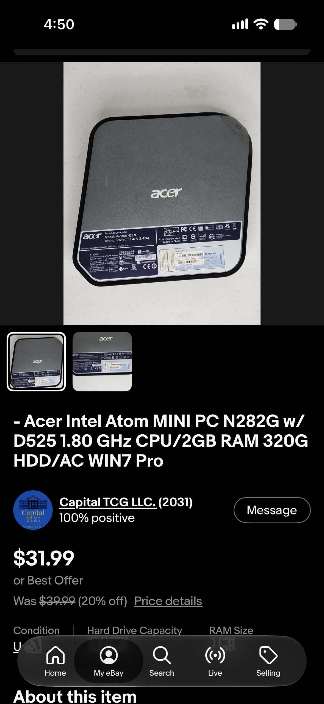

# Title: How to create a super cheap Linux Home Server
## What you'll need for this project:
-A separate PC we won't be using as our home server. Either a Windows PC or a modern Linux machine will work fine. 
 -A USB stick to use as a boot-able drive. 8 GB of storage or higher is recomended
  -A separate PC with it's own mouse and keyboard to use as our Linux home server
## Step 1:
### The first step is to find a good machine.

### Above you can see the mini PC I'm using for this project. As you can see this PC was very affordable costing only $31 on EBAY. You can find many similar machines on the used market although I wouldn't go for anything less powerful than the machine shown here as it works but if I were to do this project again I would opt for something slightly more powerful but this machine gets the job done just fine. 
```sudo nano /etc/wpa_supplicant/enterprise.conf```
