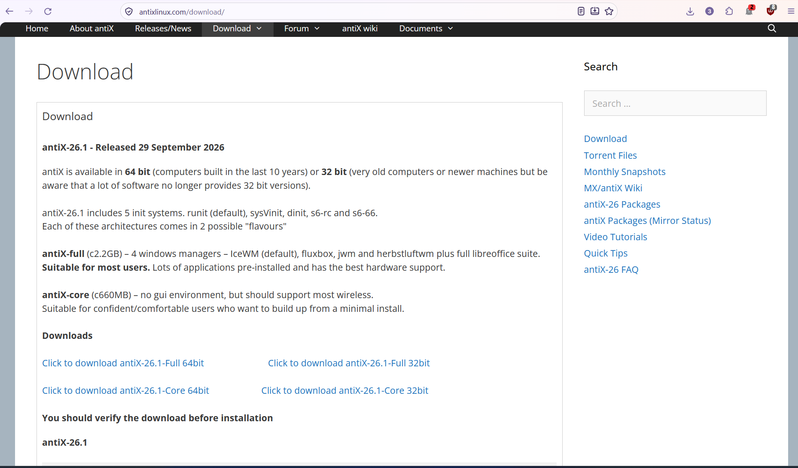
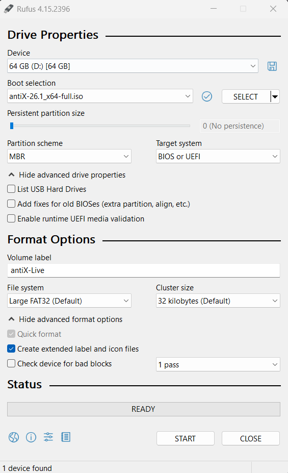
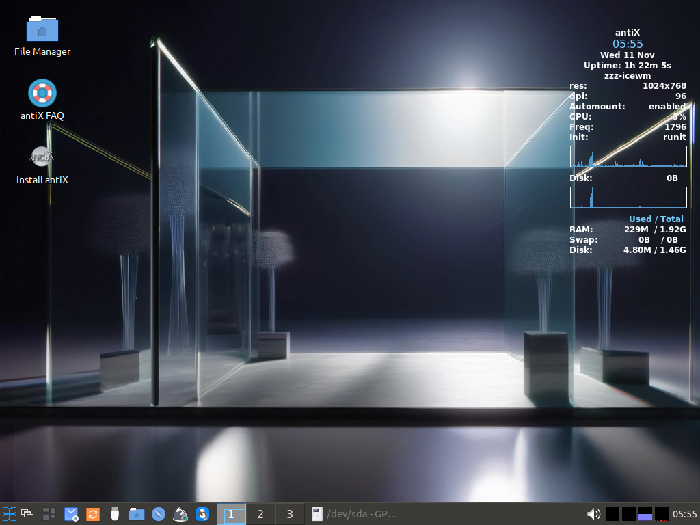
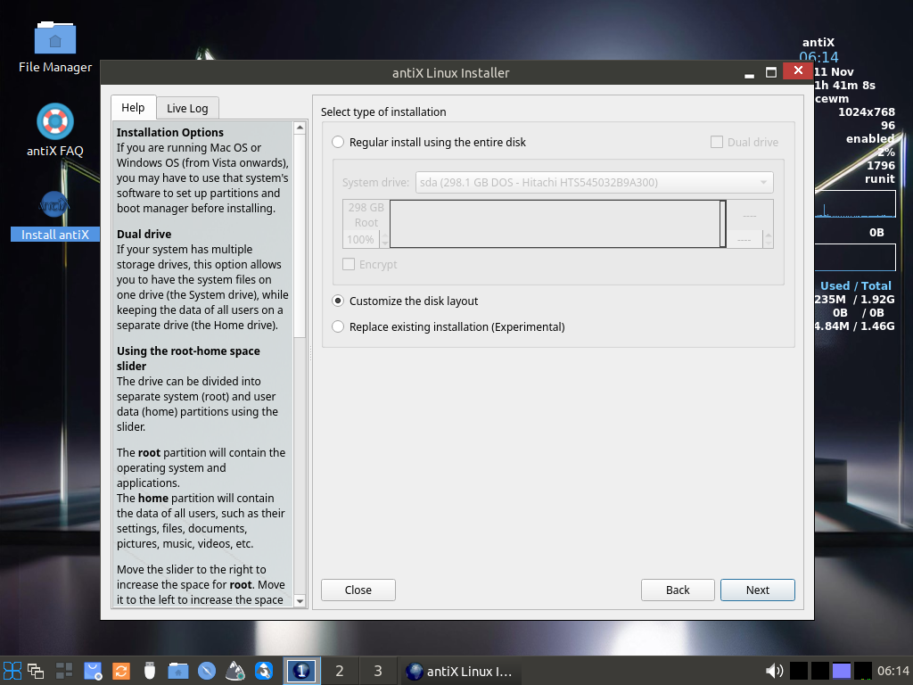
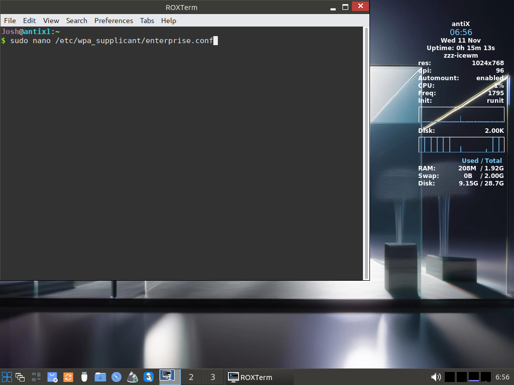
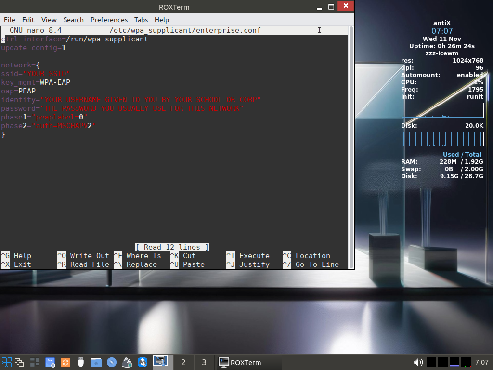
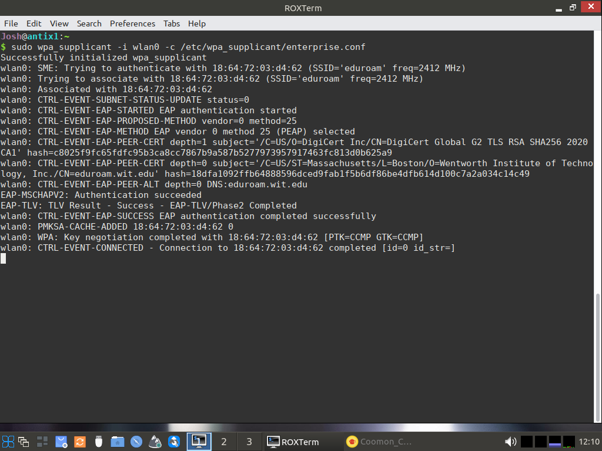

# Title: How to create a super cheap Linux Home Server
## What you'll need for this project:

- A separate PC we won't be using as our home server. Either a Windows PC or a modern Linux machine will work fine. 
- A USB stick to use as a boot-able drive. 8 GB of storage or higher is recommended
- A separate PC with it's own mouse and keyboard to use as our Linux home server
## Step 1:
### The first step is to find a good machine.

### Above you can see the mini PC I'm using for this project. As you can see this PC was very affordable costing only $31 on EBAY. You can find many similar machines on the used market although I wouldn't go for anything less powerful than the machine shown here as it works but if I were to do this project again I would opt for something slightly more powerful but this machine gets the job done just fine. The biggest requirement is that the machine must be 64 bit. Many parts of this tutorial will not work on a 32 bit machine
## Step 2:
### Preparing the Antix Linux boot-able USB:
Navigate to the official antix downloads site: https://antixlinux.com/download/ and choose the 64 bit full ISO whatever the newest version is. At time of writing the newest version is 26.1 

Next you'll want to install Rufus from https://rufus.ie/en/ Rufus will allow you to format your USB as boot-able. 
After Rufus is installed choose your USB device and ISO in the drop down menus and click START the rest of the options should be fine to leave as default. NOTE ANYTHING that you have on the USB you're formatting WILL be fully wiped. 


After Rufus has completed it's work you can remove the USB. 
## Step 3:
### Installing antix Linux using your boot-able USB:

- 1.Plug the USB Stick into the machine you intend to use as a server.
- 2.Press power and then immediately press your Boot Select key on your keyboard. This key can vary depending on the manufacturer but its usually F2 or Del but if those don't work you can always Google what key to press based on the manufacturer of the PC you're using.
- 3.Once into the boot select choose your USB as the boot option and you should be booted into the Live version of Antix Linux. There may be some prompts as you're booting in but just choose the default. 
-  4.Once in you should see a screen like this:


## Next open the antiX installer it should be sitting right on the desktop. Note: If prompted for a password the password is "demo"

Regular install using the entire disk should be fine if you don't plan on duel booting but if you do plan on duel booting a different OS choose Customize the disk layout. If customizing the disk layout simply choose the / in the drop down menu to point the root mount point to whatever partition you want to use as your Antix partition and leave the other partition untouched and un-formatted.
You can then just hit next for all subsequent pages of the installer the default options should be fine. 
Once the installer is done you can remove the USB and restart the system and it should boot into your full install of Antix Linux. 

## Step 4:
### Connecting to the internet 
If you're on a home network that requires only a SSID and password to connect you're in luck. In that case the process is super simple. Just use the connman system GUI application, navigate to the wireless tab, click your network, click connect, enter your password and you're in!

However if you're on an enterprise or university WiFi that requires a username in addition to SSID and password like I am the process isn't quite as simple. 

- Step 1:Open a terminal from the menu at the bottom left and enter the command: sudo nano /etc/wpa_supplicant/enterprise.conf and hit enter as shown below.  

- Step 2: Fill out the nano file exactly as shown in the image below.

To save your changes to the nano file hit CTRL+O then hit enter to confirm the save than hit CTRL + X to exit the nano file
- Step 3: run the following command

If successful your command output should look like this:

If this is your output press CTRL+Z to pause the command and once you have control of the terminal back type `bg` and hit enter to keep the command running in the background. If you get an error like "Kernel reports: Match already configured!" that just means you have another instance of wpa_supplicant already running. If this is the case use the following command: ```sudo killall wpa_supplicant``` This command is also what you should use anytime you want to disable your WiFI connection for any reason. I would HIGHLY recommend creating a text file on your desktop with both of these commands in it because you will most definitely want to be able to refer back to these commands at a later date if you forget them. There will also be other commands that you'll use frequently that we'll discuss later on so good to make a text file now and write those down as we get to them.  


```sudo nano /etc/wpa_supplicant/enterprise.conf```
